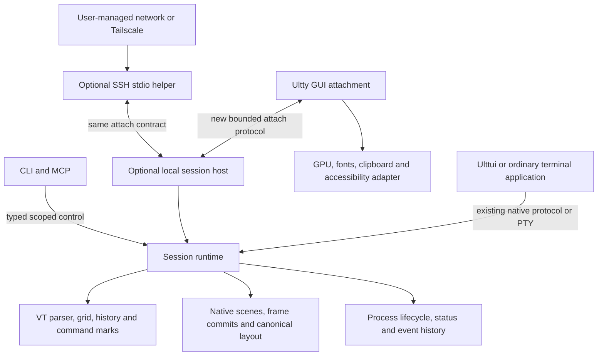

# Changes needed for Rex-style workflows and optional Tailscale access

Reviewed 2026-11-12 at `c718910`. Runtime source is unchanged from `b75af7a`; the intervening commit contains research only. This is a source review and proposed implementation plan. No runtime defect was reproduced, benchmark run, protocol changed, or networking configured during this review.

The user subsequently authorized the full roadmap in stages. See the [implementation record](rex-implementation-progress.md) for changes and validation on the isolated feature branch. The review below describes the pre-implementation source.

## Recommendation

Extend the existing architecture in three steps: make local automation and native pane behavior reliable, extract a session runtime that can operate without a window, then add attachment and optional SSH transport. Complete semantic input delivery in Ulttui alongside the first step. Tailscale does not require a dependency in the terminal for the initial workflow.

Most of the foundation already exists: a separate VT crate, PTY readers, nested split layout, structured native scenes, pane-targeted control requests, events, MCP, command marks, accessibility semantics and a separate Luau application process. The missing pieces are mostly ownership and behavioral contracts. A large renderer, framework or networking rewrite would not address them.

Companion reviews provide the deeper file maps:

- [Persistent runtime and attachment](rex-session-runtime-change-map.md)
- [Native panes, status and semantic input](rex-native-ui-change-map.md)
- [Remote workflows and workspace operations](rex-remote-workflow-change-map.md)
- [Original feature/design research](../../reports/Rex%20and%20Tailscale%20design%20evaluation.md)

## Highest-priority findings

### 1. Control success does not reliably mean input was accepted

`SendText`, `SendRaw`, `RunCommand` and `forward_key_to_pty` discard `EventLoop::send_input` errors and return success. That API can reject closed PTYs and full outbound queues. Native `send_key_to_pane` and `send_text_input_to_pane` also return no result to the control caller. Native message output buffers append without the explicit bounds applied to PTY input and control subscriptions.

Evidence: `crates/ultty/src/app/control.rs:701`, `:750`, `:908`, `:1250`; `crates/ultty/src/event_loop.rs:500`; `crates/ultty/src/protocol/server.rs:859`; `crates/ultty/src/protocol/session/transport.rs:116`.

Change the internal routing helpers to return an acceptance result. Map missing target, closed recipient and queue pressure into explicit control errors. For native delivery, define recipient selection and partial fan-out behavior before returning success. Add byte limits to outbound native queues; never silently discard user input or protocol replies. Reserve an application acknowledgement for operations that promise application, as override requests already do.

An accepted queue write is not executed shell input or completed work. Reflect that distinction in CLI/MCP descriptions and result types. Existing keyboard paths may log refusal; automation must receive it.

### 2. Shell typing and argv-preserving process launch are different operations

`RunCommand` sends `command + args.join(" ") + newline` into the foreground PTY. An argument containing spaces loses its boundary, and shell syntax is interpreted by whatever program receives the line. `NewTab` and `SplitPane` already have direct child-spawn paths with argv arrays. Do not add a second process launcher to fix `RunCommand`.

Evidence: `app/control.rs:908`, `:766`, `:812`; `terminal_manager.rs:901`; `pty/child.rs:61`. The CLI test at `bin/ulttyctl.rs:1127` verifies request parsing only. Tests at `app/control.rs:2471` exercise a duplicate `#[cfg(test)]` formatter rather than production dispatch. They cannot establish end-to-end argv preservation.

Keep legacy shell typing explicitly named/documented while introducing or exposing a structured spawn operation based on new-tab/split. Use it for SSH and agent launches. Do not silently shell-quote arbitrary commands and call that a general solution. Confirm arguments by observing the launched child's argv through the real control path.

The existing spawn receipt is also weaker than successful exec: the parent returns after fork, the child tolerates a failed `chdir`, and failed `execve` exits 127. If the new contract promises successful startup in the requested directory, add a close-on-exec child error pipe carrying a bounded error code, with all descriptors and error data prepared before fork. Preserve the existing async-signal-safe child path. Alternatively, expose a clearly named allocated/starting state and report startup failure later. Do not label fork success as exec success. Evidence: `pty/child.rs:87`, `:478`, `:498`.

### 3. Run-then-wait can miss fast completion

MCP instructions recommend running a command and then waiting for `command_finished`. `PendingControlWait` observes only the next future completion event; it has no command identity or completed-result lookup. A command can finish before the wait is registered. The MCP reader handles calls synchronously, so a blocking wait also prevents a later launch call on that same connection from being handled until the wait returns.

Evidence: `control/mcp.rs:31`, `:44`; `app/control.rs:431`; `app/control_wait.rs:19`, `:97`; `app/control_events.rs:16`.

Add owner-scoped job IDs for direct spawns and bounded terminal results that survive immediate pane exit. A wait on a job checks retained completion before subscribing. For existing interactive shells, add a shell-command generation/cursor at OSC 133 boundaries and an atomic observe-before-input operation if that workflow needs reliable correlation. Command marks are shell-supplied evidence; they cannot prove arbitrary PTY text executed. Keep the old future-event wait for callers that genuinely want the next event. Do not treat a quiet period as successful completion.

### 4. A stale automation target can resolve to another window

`find_instance` prefers `ULTTY_PID` while reachable, then chooses the newest running instance. MCP repeats discovery for every call. A client with an old pane ID can therefore address a different instance after its original window exits. IDs are manager-local counters, not globally stable references.

Evidence: `control/paths.rs:55`, `:82`; `bin/ulttyctl.rs:174`, `:819`; `terminal_manager.rs:55`, `:153`. The fallback is explicitly tested in `control/paths.rs`, so changing it is a contract change, not an unnoticed implementation detail.

Introduce an explicit owner identity and epoch, and carry them with targets returned by discovery. Pin a target for a tool workflow. If an explicitly selected owner disappears, return stale/unavailable instead of retargeting. Preserve interactive discovery as a separate user choice. Scope idempotency keys for launch operations to that owner and caller; a lost reply must not lead to duplicate agent processes after retry.

### 5. Native input loses the region identity the terminal sent

The wire input includes `region_id`. `NativeBackend::convert_input_event` discards it, returning raw mouse coordinates or key events with `focused_id: None`. `App::prepare_event` then assigns the runner's current focus. Native region keys support retained rendering, but `region_with_key` resolves a duplicate key by choosing the oldest matching region. This is insufficient for unambiguous named actions.

Evidence: `crates/ultty-protocol/src/events.rs:16`; `crates/ulttui/src/backend/native.rs:551`; `crates/ulttui/src/app.rs:591`; `crates/ulttui/src/backend/native_diff.rs:79`. The accessibility adapter logs `ActionRequested` as unhandled at `crates/ultty/src/a11y/adapter.rs:90`.

Preserve native session/region/generation identity through event conversion. Define whether application action IDs are globally unique within an app or path-qualified, independently of sibling-scoped reconciliation keys. Reject ambiguity rather than selecting an arbitrary region. Add a shared semantic action path for application input and accessibility. Start with focus and activation; add value edits only with declared capability and application acknowledgement. This finding does not imply every raw-mouse application is broken; it establishes that named semantic dispatch is incomplete.

### 6. The persistent-session boundary crosses more than PTY ownership

The GUI owns the terminal manager and native protocol server. Native in-band pumping, scene processing, layout feedback, waits and lifecycle events currently depend on GUI-owned updates. Ulttui treats a closed native connection as Quit. Moving only `Child` into a background process would preserve some PTYs while breaking native apps or freezing them without a window.

Evidence: `crates/ultty/src/app/mod.rs:130`; `app/update.rs:46`; `protocol/session.rs:101`; `crates/ulttui/src/backend/native.rs:541`; `crates/ultty/src/pty/child.rs:251`.

Extract an independently driven runtime while it still runs in-process. Move it out of process only after shell and native application tests run without GUI pumping. Keep the application-to-terminal connection distinct from the new viewer attachment. Losing a viewer must not close the application's native transport.

## Required changes by feature

Names below are proposed interfaces, not declarations of implemented APIs. Existing file paths identify seams; new module names are provisional.

| Slice | Required changes and primary owners | Compatibility and acceptance |
|---|---|---|
| C1. Honest control results | `app/control.rs`, `protocol/server.rs`, `protocol/session/transport.rs`, `control/mcp.rs`: propagate acceptance errors, bound native output, distinguish accepted/applied/completed | Old successful requests remain valid. Saturated queues and closed native/PTY recipients must return failure through CLI and MCP. |
| C2. Launch and completion | `ultty-protocol/control.rs`, `terminal_manager.rs`, `pty/child.rs`, `app/control_wait.rs`, `app/control_events.rs`, CLI/MCP: explicit shell text vs argv launch, job result retention, startup state and command correlation | Preserve legacy shell-text behavior under an explicit name. Verify space/quote/newline arguments, failed cwd/exec, immediate exit and wait-after-completion. |
| C3. Addressing and discovery | `control/paths.rs`, `ulttyctl.rs`, `control.rs`: owner epoch, stable target reference, server capabilities/schema version and supported operations | Old integer targets remain local legacy requests during migration. Strict targets never fall back to another instance. No dependency-heavy schema generator required initially. |
| C4. Recoverable events | `control/server.rs`, `app/control_events.rs`, `control.rs`: bounded revisioned snapshot and event sequence, cursor validation, explicit resync, status/native lifecycle events | Preserve legacy NDJSON via a separate versioned subscription request. Snapshot and subscription must share a mutation boundary. Test connect during mutation, overflow and owner restart. |
| N1. Native panes | `app/update.rs`, `protocol/server.rs`, `app/native_panes.rs`, inline surface/session code, `renderer/panes.rs`, `app/accessibility.rs`: replace tab/single-pane in-band and inline ownership with originating pane ownership | Reuse socket-native pane behavior. Rendering and accessibility must include pane-owned inline surfaces. Test local socket + SSH in-band + inline content across split/resize/focus/close, without broadening clipboard rights. |
| N2. Program status | `ultty-vt/ansi/osc.rs`, VT events/state, `event_loop.rs`, `terminal_manager.rs`, control types, Ulttui emitter: OSC 7501 parser, bounded record store, lifecycle cleanup, effective status projection | A single `PaneStatus` cannot hold hierarchy/reasons. Add a record model and project it into existing chrome. Use strict report decoding; the current permissive OSC 52 base64 decoder is unsuitable. Keep control-status precedence explicit. Test malformed reports, resets, prompt/exit cleanup, clear and source attribution. |
| N3. Semantic actions | `ulttui/backend/native.rs`, `native_diff.rs`, `app.rs`, `event.rs`, focus/widgets, native protocol event codec, AccessKit adapter, `ulttui-lua/runner.rs` | Preserve raw events. Route named focus/activation using committed identity; reject stale/deleted/ambiguous targets. Exercise keyboard, pointer, agent and assistive input against the same app state. |
| W1. Workspace operations | `config.rs`, `app/mod.rs`, CLI, `pane_layout.rs`, `terminal_manager.rs`, control types: actually build configured panes; targeted focus/close; later zoom and move with stable IDs | Preserve serialized split weights and existing layout restoration. Zoom should not rewrite the stored split tree. Default profile application must not restart existing commands repeatedly. |
| R1. Headless runtime | Extract reusable runtime from `app/update.rs` and manager/protocol/control ownership; create `ultty-runtime` only when dependency separation is established | Same runtime in-process first. Then prove no winit/display/GPU initialization for a headless executable, with both VT and native apps continuing to progress. |
| R2. Local session host | New optional host binary using R1; owner/socket lifecycle, explicit detach vs terminate, retained jobs/native state and deterministic shutdown | GUI death preserves child PIDs and application links. Host death is a distinct terminal failure; no reboot/process-checkpoint guarantee. |
| R3. Viewer attachment | New `attach` protocol module and viewer-side model; committed snapshots, bounded updates, owner epoch, controller lease and canonical viewport | Begin with one controller and read-only observers. Disconnect slow clients or resnapshot; never let one observer resize or stall the whole session. |
| T1. SSH/Tailscale workflow | Ordinary argv-preserving SSH launch, named profiles and Ulttui diagnostics; later a narrow SSH stdio attach helper using R3 | External Tailscale is optional. Existing SSH-native fallback limits remain explicit until N1 passes. No local privileged socket/token forwarding. |
| T2. Remote authority | Attach helper policy: read/input/spawn/layout capabilities, explicit expiry/revocation and controller transfer; viewer-only clipboard mediation | Required before a remotely accessible Ultty service, including private tailnets. Existing local authenticated boolean is not a multi-user permission model. |

## Proposed ownership and types



Keep protocol roles separate: the current native protocol describes an application's UI; the control protocol performs operations and reads state; the new attach protocol reconstructs a viewer. Reusing their common typed content is useful. Calling all three a `Session` without distinct types would obscure their lifetimes.

Minimal concepts for the design review:

```text
OwnerRef       = owner_id + epoch
PaneRef        = owner_ref + pane_id
NativeTarget   = pane_ref + app_session_id + committed_generation + region_id
JobRef         = owner_ref + job_id
EventCursor    = owner_ref + sequence
Attachment     = viewer_id + granted_capabilities + controller_state
LaunchSpec     = program + argv + cwd + explicit_environment
JobState       = starting | running | exited | startup_failed
ConnectionState= connecting | attached | reconnecting | unavailable
```

Do not mix job state with connection state or program-reported status. A lost connection leaves job status unknown until refreshed. A claimed `blocked:permission` status supplies no authority. One controller initially owns PTY dimensions and native layout/input decisions. Viewer-local selection, zoom and scroll need separate policy from app-controlled focus/scroll state.

Native scene inspection is not a serialization format for attach. Inventory the full VT/parser and native state, including partial escape sequences, alternate screen, modes, history/command marks, committed versus pending frames, resource IDs, subscriptions, stream state, inline anchors and focus. The runtime remains authoritative; a viewer snapshot should include only what rendering and inspection require, with explicit update generations. Parser and partial-escape state stay in the runtime under this semantic snapshot design; transmitting them would only be necessary if a different design made viewers replay raw bytes. Do not deserialize arbitrary internal structs as the long-term wire format.

Current native layout uses Taffy in cell units and Unicode column widths for text wrapping. Renderer font metrics supply cell/pixel sizing. Audit that boundary for headless operation; this is not evidence that the runtime needs GPU font shaping. A headless process that needs a viewer callback to advance a native app is not independent.

## Order of work and stop gates

1. **C1 and C2 first.** Reproduce failures through real request dispatch, then fix input acceptance and separate launch semantics. Add completion identity before advertising reliable run-and-wait. Existing new-tab/split spawns are the control.
2. **N1 and N2 next, as independent slices.** Finish pane ownership and interoperable status. These improve the current product without introducing a daemon. Stop on cross-pane input or clipboard authority regression.
3. **N3 plus C3/C4.** Establish semantic identity, stable automation targets and recoverable observation. First implement focus/activation; leave unsupported actions explicitly unavailable. Runtime-owned snapshots and sequences should work in-process before remote clients exist.
4. **W1 and T1 launch/diagnostics can proceed independently.** Finish configured panes and ordinary SSH workflows using existing spawn paths. Persist connection recipes only as explicit restart instructions. They do not restore running work.
5. **Design the full native/VT ownership contract, then implement R1.** Do not extract only PTYs and postpone the native dependency analysis. Prove in-band pumping, process-group pane binding, native keepalives, viewport synchronization and inline anchor/surface pairing progress without a GUI. Retain current in-band restrictions until N1 changes them. Price shipped dependency closure and a real headless build. Retain the existing in-process launcher for rollback.
6. **R2/R3 local detach, then observers.** Kill a viewer during streaming and during a native frame, reconnect, check identical child PIDs and committed state, and stall a second viewer. Also stop a native producer from reading replies; bound its socket and in-band queues independently from viewer queues. Require explicit failure/disconnection on overflow, no partial-frame publication, bounded memory and explicit controller transfer. Host crash recovery is a separate scope.
7. **T1 remote attach plus T2 authority last.** Reuse the local attach protocol over explicitly launched SSH. Test transport loss separately from host loss and in-band expiry. A network/Tailscale diagnostic result never becomes a permission grant.

No fixed delivery estimate is justified by this static review. C/N/W slices are bounded changes to current behavior; R1-R3 are architectural work. The investigation caps in the original report are stop points for prototypes, not estimates for shipping the whole table.

## Verification and rollback

For code changes, retain the repository's format, clippy, workspace tests and relevant smoke gates. Add meaningful end-to-end cases rather than more serializer-only tests:

- Extend `scripts/e2e/exec-flag.sh` and control integration coverage with child-observed argv/cwd, launch errors, queue refusal and immediate completion.
- Extend `scripts/e2e/native-split.sh`, `inline-surface.sh`, `native_focus.py` and `native_semantics.py` with pane-owned in-band and identity-preserving actions.
- Extend VT OSC tests and parser fuzzing for bounded program status. Exercise status clearing through actual prompt/reset/exit events.
- Extend MCP tests with owner replacement, fast command completion and explicit target selection. Verify the server capability description matches implemented requests and tool exposure.
- Extend AccessKit consumer tests and `scripts/e2e/atspi_widgets.py` for action dispatch. Record real Orca/VoiceOver results separately from tree snapshots.
- New host/attach integration tests need no display: destroy and reconnect viewers, inject sequence gaps, stale epochs, partial frames, oversized state and slow readers. Add a GUI comparison for rendered/copy behavior afterward.

Measure the whole process set and all retained state: host plus GUI RSS, pane threads, history pages, native resources, per-client queues, input latency and idle wakeups. The existing one-reader-thread-per-PTY model and packed history remain the incumbent. A reactor or shared buffer representation should follow evidence, not be bundled into ownership extraction.

Version new control/attach contracts and retain an explicit local legacy route during migration. Keep the session host and remote helper optional until their gates pass. Preserve old saved layout readability. Rollback disables the optional host/helper and returns to in-process runtime, without pretending existing jobs can migrate between those owners automatically.

## Scope decisions before implementation

The user requested review and change identification. This document does not accept new ADRs or begin API work. The current North Star requires explicit scope for protocol/schema changes, and generic desktop remoting remains out of scope. An optional session host can fit a terminal-specific model; a network listener changes the README's current no-networking promise.

Do not add a VPN/control plane, public Funnel endpoint, built-in identity provider, browser client, process checkpointing, shared simultaneous typing, or a new in-process scripting VM to this plan. Full floating panes and native platform-specific client chrome are later UX choices, not prerequisites for persistence or semantic automation. The highest-value first deliverable is reliable control, native pane ownership and named interaction on the existing local architecture.
